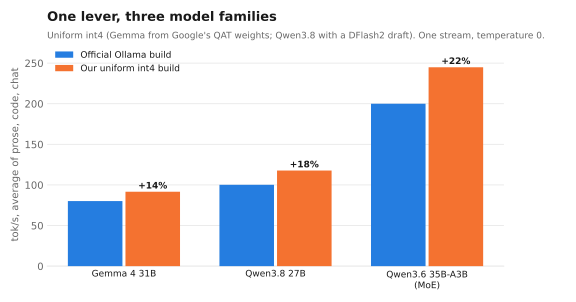
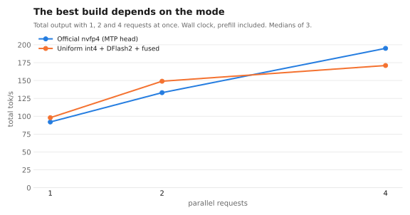

# Mac Studio M5 Ultra LLM lab

Open research on making local LLM inference faster on one Apple Mac Studio
(M5 Ultra, 96 GB unified memory, 1.2 TB/s, 80 GPU cores with Neural
Accelerators). We patch the open-source stack, mainly
[Ollama](https://github.com/ollama/ollama) and its
[MLX](https://github.com/ml-explore/mlx) runner, measure every change on
real models, and offer what works upstream.

**Status (2026-11-27, evening):** in production on our own Mac Studio.

| What | Before | Now | How |
|---|---|---|---|
| Writing speed, Qwen3.8 27B (avg of prose, code, chat) | 99.7 tok/s | **128.6 tok/s (+29%)** | uniform int4 build + DFlash2 draft |
| First word on a chat follow-up (10k–70k tokens) | 0.7–4.2 s | **0.12–0.25 s** | turn-start snapshots (patch 0006) |
| First word on a follow-up at 139k tokens | 12.5 s | **0.46 s** | same |
| Total speed, 8 chats at once | 168 tok/s | **265 tok/s (+58%)** | upstream PR #19769 |
| First word after a model unload or restart (21k chat) | 13.9 s | **1.4 s** | upstream PR #19745 + write-back delay (patch 0007) |

Also measured: Gemma 4 31B +14% and Qwen3.6 35B-A3B +22% from the same
uniform 4-bit lever. Not reached: +50% single-stream decode on prose and
chat; the draft is accepted for only ~1.5 tokens per round there (see the
results log).

<picture>
  <source media="(prefers-color-scheme: dark)" srcset="charts/models-dark.svg">
  
</picture>

<picture>
  <source media="(prefers-color-scheme: dark)" srcset="charts/decode-dark.svg">
  
</picture>

**Code:** our Ollama patches live on branch
[`atlas-dev` of madisonicus/ollama](https://github.com/madisonicus/ollama/tree/atlas-dev)
(on top of v0.40.18), and branch
[`atlas-next2`](https://github.com/madisonicus/ollama/tree/atlas-next2): upstream main
plus open PRs #19745 and #19769 plus our patches, which atlas runs in
production since 2026-11-27 (`atlas-next` is the same without #19745). `patches/` keeps a copy of each of ours.

## Scope

| Axis | What we test |
|---|---|
| Models | Qwen3.8 27B (dense, hybrid linear attention, MTP head), Qwen3.6 35B-A3B (MoE), Gemma 4 31B, Inkling 2 Mini, abliterated variants |
| Formats | nvfp4, mxfp4, affine int4, 8-bit mixes, uniform vs mixed policies |
| Drafting | none, built-in MTP head, DFlash2 block drafts, grafted heads |
| Modes | single stream; 2–8 parallel streams; long context (30k–140k) and prompt-cache reuse; voice-style short answers with thinking off |
| Stack | Ollama 0.40.18; its bundled MLX (Nov 6) vs MLX 0.32.5 |

## Goal

Cut the time from send to last word in half against the baseline, with no
loss of quality, and send each patch that helps upstream. Part goal for
decode: +50% single-stream tok/s on Qwen3.8 27B, averaged over prose, code
and chat.

## Method

- Idle machine only. Temperature 0, 400 output tokens, three prompt kinds
  (prose, code, chat). Scripts in `bench/`.
- Arms run interleaved, A/B/A/B, so drift hits every arm alike.
- Noise floor (A/A, same build, 20 runs): the median-to-median gap is under
  0.1% at the 95th percentile. But between separate test runs we saw ±2%
  (padding rows, fusion flipped sign), so we treat gains under 2% as unproven.
- Small gains count, and they interact: patches are tested inside the stack
  they ship in, then left out one at a time.
- Quality gate for any build we would ship: 20 tool calls and six
  blind-graded tasks (long-context recall, incident triage, message triage,
  bulk classification, safe shell commands, multi-step planning), graded by
  a separate model that does not see which build wrote the answer.

## Results log

| Date | Change | Measured | Note |
|---|---|---|---|
| 2026-11-27 | Baseline, official `qwen3.8:27b-nvfp4` | 99.7 tok/s avg (prose 91.7, code 124.1, chat 83.3); plain decode without MTP 52.4 | `bench/decode.py` |
| 2026-11-27 | Peak bandwidth | 1,150 GB/s read | `bench/bw.py`; plain decode uses 66% of it |
| 2026-11-27 | Kernel timing, one decode step | matmuls 14.3 of 19.1 ms; 2–4 rows cost 1.3–2.2x one row on nvfp4; affine 4-bit 1.1x from 4 rows | `bench/qmv.py` |
| 2026-11-27 | Uniform nvfp4 (no 8-bit layers) | 107.5 vs 100.2 (+7.3%) | patch 0002, `OLLAMA_QUANTIZE_UNIFORM=1` |
| 2026-11-27 | Uniform int4 + pad 2–3 rows to 4 | 111.6 vs 100.2 (+11.4%); code 157.8 | patch 0002, `OLLAMA_MLX_PAD_ROWS=1` |
| 2026-11-27 | Padding alone (int4) | 109.9 vs 105.1 (+4.6%) | |
| 2026-11-27 | Fused output gates (qwen3.5) | 109.6 vs 109.1 (+0.5%) | patch 0002, `OLLAMA_MLX_FUSE=1`; kept |
| 2026-11-27 | Quality, uniform int4 | 20/20 tool calls; blind tasks 0.82 vs 0.83 official | same grader |
| 2026-11-27 | Newer MLX 0.32.5 (libmlx from the PyPI wheel, swapped into the dev build) | official 99.7 (no change) | runs cleanly; MLX version shows 0.32.5 |
| 2026-11-27 | Interaction: padding on MLX 0.32.5 | code 139.3 with padding vs 147.6 without (−5.6%) | MLX 0.32.5 has its own small-row path; padding now hurts |
| 2026-11-27 | MLX 0.32.5, int4u, no padding | 111.4 avg | same +11% as old MLX with padding |
| 2026-11-27 | MLX 0.32.5, fusion on vs off (int4u, no pad) | 108.3 vs 110.2 | fusion −1.7% here; it was +0.5% on old MLX |
| 2026-11-27 | MLX 0.32.5, uniform nvfp4 + fusion | 108.3 (prose 102.3, code 132.4, chat 90.2) | nvfp4 leads prose and chat, int4 leads code |
| 2026-11-27 | MLX 0.32.5, official DFlash2 build | 108.2 (code 149.1) | z-lab DFlash2 draft |
| 2026-11-27 | MLX 0.32.5, uniform int4 + DFlash2 draft (`DRAFT` in the Modelfile) | **117.1** (prose 99.1, code 166.8, chat 85.3) vs MTP 109.0 | best so far: +17% over official |
| 2026-11-27 | uniform nvfp4 + DFlash2 | 117.0 (prose 93.2, code 170.1, chat 87.8) | same average as int4; int4 better on prose |
| 2026-11-27 | uniform int4 + DFlash2 + fused gates | **117.7** vs 117.0 without (+0.6%) | fusion helps again in this stack |
| 2026-11-27 | DFlash2 `draft_num_predict` 4, 7, 10, 14 | 118.1 at every value | the option has no effect on the MLX runner |
| 2026-11-27 | Parallel, total tok/s at 1 / 2 / 4 requests: official vs best stack (int4 + DFlash2 + fusion) | official 92 / 133 / 195; best 98 / 149 / 171 | best stack wins at 1–2 streams, loses at 4: DFlash2 drafts cost more in a batch than the MTP head |
| 2026-11-27 | Patch idea: plain decode above 2 active requests (`OLLAMA_MLX_DRAFT_MAX_ACTIVE=2`) | 100 / 143 / 115 / 150 at 1 / 2 / 3 / 4 | negative: drafting still pays at 3–4 streams in this stack. Not kept |
| 2026-11-27 | Temperature 1.0 (as Open WebUI uses), official vs best stack | 101.8 vs **114.1 (+12%)**; code 121.9 vs 148.9 | gains hold with sampling, a little smaller than at temperature 0 |
| 2026-11-27 | Gemma 4 31B: uniform int4 from Google's QAT weights + its assistant draft (MLX 0.32.5) | **91.6 vs 80.1 (+14%)**; prose 85.8, code 118.9 (+23%), chat 70.0 | the uniform 4-bit lever carries over to a second model family |
| 2026-11-27 | Gemma 4 31B: same with uniform nvfp4 | 84.9 (+6%) | affine int4 beats nvfp4 here too |
| 2026-11-27 | Quality, Gemma int4 QAT | 19/20 tool calls (official 19/20); blind tasks 0.90 vs 0.87 official | QAT weights hold quality at 4 bits |
| 2026-11-27 | Long chat, 139k tokens, follow-up turn | 131,071 tokens from cache, 13.1 s to first word, with the default 8 GiB snapshot budget and with 32 GiB (patched `OLLAMA_MLX_SNAPSHOT_GB`) | the stop at 2^17 − 1 tokens is not the snapshot budget; cause still open |
| 2026-11-27 | Qwen3.6 35B-A3B (MoE): uniform int4 from the bf16 weights, MTP head kept | **244.9 vs 200.0 (+22%)**; prose 224.4, code 292.0, chat 218.2 | the lever also works for MoE kernels |
| 2026-11-27 | Quality, Qwen3.6 35B-A3B int4 | 19/20 tool calls (official 20/20); blind tasks 0.68 vs 0.75 | possible quality cost: one wrong shell command (0/5) decides most of the gap; needs more samples before use |
| 2026-11-27 | Qwen3.6 35B-A3B int4, a real vision job: 44 hand-labeled wildlife photos, keywords from a fixed list | F1 0.849 vs 0.874 official (precision 0.853 vs 0.895, species recall 0.972 vs 0.944); 1.12 vs 1.21 s per photo | small quality loss and only 7% faster: per-photo time is mostly image prefill, not decode. Not worth it for this job |
| 2026-11-27 | Voice-style mode: ~700-token system prompt, short spoken-style questions, thinking off, streaming, 12 runs | first word 140 ms official vs 169 ms best stack; whole short answer 371 vs 330 ms | the draft adds ~30 ms before the first word but finishes 11% sooner; both far below speech-synthesis time, so voice is not limited by the LLM here |
| 2026-11-27 | Prompt reading (time to first word), Qwen3.8 27B, 8k and 30k prompts, 3 interleaved runs | uniform int4 1,738 / 1,553 tok/s vs official nvfp4 1,565 / 1,415 (**+11% / +10%**); MLX 0.32.5 vs stock: no difference | uniform int4 also cuts time to first word by about 9% |
| 2026-11-27 | Prefill chunk size (patched `OLLAMA_MLX_PREFILL_CHUNK`; Ollama fixes 2048), uniform int4, pairwise vs default | 1024: 1,728 / 1,557; 4096: 1,738 / 1,565; 8192: 1,729 / 1,544 tok/s at 8k / 30k, all within 1% of 2048 | no effect on the dense model (the MLX counterpart of llama.cpp's `--ubatch-size`) |
| 2026-11-27 | Memory growth under a game-like load (4 parallel 6-turn chats with a shared 6k system prompt, 10 min), Qwen3.6 35B-A3B | stock: runner grew 23 → 79 GB, 12.8 GB swap, 133 chats done. With patched `OLLAMA_MLX_MAX_ACTIVE_GB=40`: 42–47 GB, no swap growth, **134 chats done** | the saved prompt history grows into all memory the host reports free, ignoring other runners. A cap costs no throughput here |
| 2026-11-27 | Where a speculative round spends its time (Qwen3.8 27B uniform int4, MTP, debug cost model and a per-block profiler) | plain step 17 ms; any draft round 26–29 ms. GPU busy 98–100% (powermetrics), so no host gap. Verify at 4–6 rows adds ~6 ms (MLP +3, linear attention +2.3, attention +0.9); each draft token ~1.2 ms, of which the 248k-row lm_head is the largest part | prose and chat accept only ~1.5 tokens per round (code 3.1), so the round overhead eats most of the draft gain |
| 2026-11-27 | Small draft vocabulary: the MTP head proposes from N tokens only, full lm_head still verifies (patch 0004, `OLLAMA_MLX_DRAFT_VOCAB`, `_FILE`) | lowest 32k ids: prose +3%, chat −8%. Frequency-ranked 32k: prose +11%, code −17%. **Mixed list (low ids and ranked ids interleaved), 48k: prose +8%, code +5%, chat +3% over full-vocab MTP**. On the DFlash2 build: −3% avg (code −7%) | the draft head saves more on one-token MTP steps than on DFlash2, which unembeds 7 rows in one pass. Same idea as FR-Spec (2025). Best avg is still int4u + DFlash2 at 117 tok/s; MTP + 48k leads chat (95 vs 86) |
| 2026-11-27 | MTP depth controller | one series stuck at depth 1 for 12+ requests (code fell to 114 tok/s); not reproduced in 41 more requests with probe backoff 512 or 16 | the probe backoff (up to 512 rounds) and acceptance EWMA (alpha 0.1) make recovery slow once a deep position looks bad; watching for a repro |
| 2026-11-27 | Matmuls of one step chained in model order (`bench/qmv_chain.py`, affine 4-bit, MLX 0.32.5) | rows 1: 15.75 ms, 2: 16.93, 3: 19.88, 4: 18.35, 8: 18.55 | with real dependencies, 4 rows cost +16% and 8 rows +18%: verify width past 4 is almost free. Only 3 rows is a slow outlier. `qmv.py` overlapped independent matmuls and understated the 2-row case |
| 2026-11-27 | Row padding variants with the 48k draft head: none, 3→4 only (`OLLAMA_MLX_PAD_ROWS=3`), 2–3→4 | avg 113.7 / 113.6 / 115.5 tok/s | all inside the ±2% run-to-run spread of this test |
| 2026-11-27 | Draft second choice at a rejection, 6 varied prompts per kind (`OLLAMA_MLX_ALT_STATS=1`, `bench/alt.py`) | at the first draft position the target token was the draft's second choice in **53% (prose) and 44% (chat)** of rejections; 39% and 35% over all positions | the target token after a first-position rejection is already free, so a second branch gains only the token after it: about +0.11 tokens per round on prose (21% of rounds reject at position 1, times 53%), near +4%. Small for the work a forked recurrent state needs. A better-trained draft is the larger lever |
| 2026-11-27 | Self-distill the MTP head (`mtp/`): 740 of the target's own greedy chat answers (UltraChat prompts, ~300k tokens), labels = the 4-bit target's argmax, fp32 AdamW, 2 epochs, lr 1e-6 | held-out step-1 agreement **80.66% → 80.79%** (loss 0.653 → 0.630); train loss fell to ~0.42. lr 2e-5 and 3e-6 on smaller data made it worse (72%, 81.3% from 82.1%) | negative at this scale: Qwen's head already fits the model's own chat output, and the small gain does not pay for a new package. Draft quality needs a different idea (a larger or tree draft), not a fine-tune |
| 2026-11-27 | **Follow-up turn, chat client flow** (history unchanged except the date stamp leaves the previous user message), Qwen3.8 27B int4u, `bench/turns_ab.py`. Stock vs patch 0006 (`OLLAMA_MLX_TURN_SNAPSHOTS=1`: also save state at the start of the last chat turns) | first word at 3.6k / 10k / 21k / 42k / 70k / 139k tokens: stock **2.02 / 1.45 / 3.13 / 0.73 / 4.21 / 12.5 s**; patched **0.11 / 0.12 / 0.15 / 0.19 / 0.25 / 0.46 s** | a hybrid model cannot rewind its recurrent state, so a prompt that diverges inside the previous turn restores to the last 8192-token mark (or 0) and reads the rest again. This was the "131,071 stop": not a 2^17 limit, only the 16th mark. 10–30x faster follow-ups |
| 2026-11-27 | Open upstream PR [#19769](https://github.com/ollama/ollama/pull/19769) (batch DFlash2 drafts and recurrent replay across requests), int4u + DFlash2, total tok/s, median of 3 (`bench/conc.py`) | 1 client 98.2 → 98.1; **4 clients 184 → 203 (+10%)**; **8 clients 168 → 265 (+58%)** | the PR's own M5 Max numbers hold on M5 Ultra. Without it, 8 clients were slower than 4. Went to production on atlas with our patches (branch `atlas-next`, later `atlas-next2` with #19745) |
| 2026-11-27 | Open upstream PR [#19745](https://github.com/ollama/ollama/pull/19745) (save conversation caches to disk, restore after unload or restart), 21k-token chat, `bench/persist.py` | follow-up after a model unload **13.9 → 1.5 s**; after an Ollama restart **13.8 → 1.3–1.5 s** (most of it model load). Combined with #19769 and our patches (branch `atlas-next2`): same, speed within 1–3% | cost: **~2.2 GB written to the SSD per chat turn** on a 15k chat (iostat, 5 turns), 8.8 GB on disk for one chat. Not shipped: with models pinned in memory, unloads are rare, and the writes would wear the soldered SSD under batch jobs |
| 2026-11-27 | Write-back disk cache: #19745 plus our `OLLAMA_KV_CACHE_WRITE_DELAY` (patch 0007; the PR waits 100 ms), 10m, policy `warm`, 15k chat | 5 turns 10 s apart: **11,054 MB → 7 MB** of disk traffic. Unload: one 2.2 GB write, 1.5 s; follow-up after it 1.37 s (14,706 of 14,723 cached). Restart: stop 1.4 s, then 1.37 s to first word | Ben's idea: write a conversation when it goes idle or its memory is needed, not after every turn. Shutdown, unload and memory pressure already skip the delay in the PR, so nothing else changes |
| 2026-11-27 | Production check: int4u + DFlash2 on prod Ollama (patched, stock MLX libraries), 3 runs per kind | **128.6 tok/s avg (+29%)**: prose 107.8, code 189.6, chat 88.3 (medians) | higher than the test server's 117 (MLX 0.32.5 there; code 190 vs 167). Only 3 runs, and the test-server gap is not explained yet |
| 2026-11-27 | Draft acceptance by position (`OLLAMA_MLX_ALT_STATS=1`, 6 varied prompts per kind, 1 slot): rate at position k given positions 1..k-1 were accepted | DFlash2 prose 0.73, 0.65, 0.59, 0.54, 0.62, 0.38, 0.52; chat 0.72, 0.62, 0.58, 0.63, 0.60, 0.58, 0.50; code 0.90, 0.84, 0.81, 0.84, 0.75, 0.82, 0.83. MTP prose 0.76, 0.64, 0.57; chat 0.77, 0.66 (its controller stops at depth ~2 there) | no collapse after position 1: each position is accepted ~60–75% of the time on prose and chat. At that rate even an endless free draft gives at most ~p/(1-p) ≈ 2.3 accepted tokens, ~3.3 per round with the free one; +50% needs ~3.8. **So +50% decode on prose and chat is out of reach with these drafts**, at any kernel speed. Only a draft that is right ≥80% per token, or a relaxed accept rule, can reach it |
| 2026-11-27 | Owner latency during batch work (`bench/qos.py`): one streamed 400-token chat while N background chats run, int4u + DFlash2, temperature 0.7, median of 4 | idle 98.6 tok/s, first word 0.07 s. **1 background: 76.5 (−22%)**; 3: 48.7 (−51%), 0.14 s; 7 (8 slots): 33.7 (−66%), 0.22 s | the goal "owner within 15% of idle during batch jobs" fails with one background stream already. Fair sharing cannot meet it; the owner's request needs priority (pause batch streams while it runs). Next patch |

## Model matrix (2026-11-27, idle atlas, Ollama 0.40.18)

Single stream: medians of 5 runs per prompt kind, temperature 0, thinking off.
4 streams: total tok/s with 4 prose requests at once, wall clock, median of 3.

| Model | Type | Prose | Code | Chat | Avg | 4 streams | With MLX 0.32.5: avg / 4 streams |
|---|---|---|---|---|---|---|---|
| `qwen3.8:27b-nvfp4` | dense 27B, MTP head | 93.1 | 116.8 | 85.7 | 98.5 | 212 | 101.4 / 208 |
| `qwen3.6:35b-a3b` | MoE 35B, 3B active | 187.9 | 226.9 | 179.6 | 198.1 | 322 | 192.1 / 311 |
| `gemma4:31b` | dense 31B | 79.1 | 96.3 | 65.0 | 80.1 | 188 | 80.3 / 188 |
| `inkling-2-mini:26b-a5b-nvfp4` | looped MoE 26B | 84.6 | 94.8 | 79.1 | 86.2 | 84 | 88.1 / 86 |

- Swapping in MLX 0.32.5 alone moves every model by 3% or less. Its value is
  in combination with other patches (see the Qwen3.8 rows above).
- Inkling 2 Mini gains nothing from 4 parallel requests (84 vs 86 for one).
  Its looped layers very possibly keep the MLX runner from batching it.
- Inkling's thinking cannot be fully turned off in Ollama 0.40.18, so its
  tok/s here include hidden reasoning tokens.

## What we learned so far

<picture>
  <source media="(prefers-color-scheme: dark)" srcset="charts/bandwidth-dark.svg">
  
</picture>

<picture>
  <source media="(prefers-color-scheme: dark)" srcset="charts/rows-dark.svg">
  
</picture>

<picture>
  <source media="(prefers-color-scheme: dark)" srcset="charts/parallel-dark.svg">
  
</picture>

- Patches interact. The same padding patch is +4.6% on the MLX that Ollama
  0.40.18 ships and −5.6% on code with MLX 0.32.5. Fusion flips sign too. So
  every patch is judged inside the stack it ships in.
- The format that wins depends on the text: nvfp4 is faster on prose and chat,
  int4 on code, where MTP drafts deeper and cheap 4-row verifies pay off.
- The best stack depends on the mode: DFlash2 wins one or two streams, the
  official MTP build wins four parallel streams.
- Best so far: +29% (128.6 tok/s on prod, 117 on the test server) against 100, from uniform int4 with a DFlash2 draft. The +50% goal needs more
  accepted tokens per weight pass, not only kernels.

## Patches (`patches/ollama`)

Each patch is off unless its environment variable is set. 0001–0006 were
written against v0.40.18 (branch `atlas-dev`); production runs them on
upstream main with PRs #19745 and #19769 (branch `atlas-next2`), plus 0007
and 0008.

1. `OLLAMA_MLX_SPECULATIVE=0`: turn draft heads off, to measure them.
2. `OLLAMA_QUANTIZE_UNIFORM=1` (create), `OLLAMA_MLX_PAD_ROWS=1` and
   `OLLAMA_MLX_FUSE=1` (runner).
3. Runner knobs: `OLLAMA_MLX_MAX_ACTIVE_GB` (memory cap per runner),
   `OLLAMA_MLX_PREFILL_CHUNK`, `OLLAMA_MLX_SNAPSHOT_GB`, `OLLAMA_MLX_DRAFT_MAX_ACTIVE`.
4. `OLLAMA_MLX_DRAFT_VOCAB` and `OLLAMA_MLX_DRAFT_VOCAB_FILE` (small draft head,
   token list from `bench/token_rank.py`), `OLLAMA_MLX_PROFILE=1` (time per block,
   research only), `OLLAMA_MLX_PROBE_MAX` (depth probe backoff cap).
5. `OLLAMA_MLX_PAD_ROWS=3` (pad only 3 rows), `OLLAMA_MLX_ALT_STATS=1` (draft
   second-choice counts, research only).
6. **`OLLAMA_MLX_TURN_SNAPSHOTS=1`**: save state at the start of the last chat
   turns. In production.
7. **`OLLAMA_KV_CACHE_WRITE_DELAY`** (for PR #19745): write a conversation to
   the disk cache once it is idle, not after every turn. In production (10m).
8. **`no_cache_persist`** request option: keep a request out of the disk
   cache. Open WebUI's Temporary Chats send it. In production.

Built Go-only on the Mac (`go build`), with the MLX libraries of the shipped
Ollama next to the binary. No Xcode needed. To try MLX 0.32.5, copy
`libmlx.dylib` and `mlx.metallib` from the `mlx` PyPI wheel into
`mlx_metal_v4/` next to the binary.

## Upstream leads

Drafts of the issues we plan to file are in `upstream/`.

- MLX: no fast fp4 kernel for 2–5 rows on NAX GPUs (`use_qmv_mma` min_rows 6);
  affine has one from 4 rows (#4787, #4827). A fp port for 2–5 rows would
  speed up MTP verification and batched decode.
- Ollama: follow-ups re-read up to 8k tokens because the prefix cache saves
  recurrent state only every 8192 tokens (fixed by patch 0006; issue draft in
  `upstream/`). No KV quantization on MLX; no request priority.
- Ollama open PRs we tested: #19769 (batched DFlash2 drafts, +58% at 8
  clients) and #19745 (disk cache; 2.2 GB written per turn unless writes wait
  for idle, our patch 0007). Both run in production here. #18358 is not
  needed for Qwen3.8.

## Charts

`charts/make_charts.py` draws every chart, light and dark, from the numbers in
the results log.

## License

MIT, as Ollama. See `LICENSE`.
