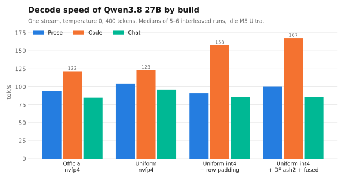
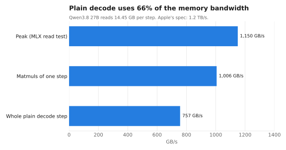
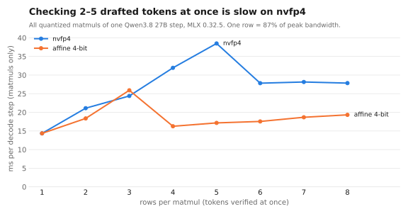

# Mac Studio M5 Ultra LLM lab

Open research on making local LLM inference faster on one Apple Mac Studio
(M5 Ultra, 96 GB unified memory, 1.2 TB/s, 80 GPU cores with Neural
Accelerators). We patch the open-source stack, mainly
[Ollama](https://github.com/ollama/ollama) and its
[MLX](https://github.com/ml-explore/mlx) runner, measure every change on
real models, and offer what works upstream.

**Status (2026-11-27):** best single-stream decode on Qwen3.8 27B is
**117 tok/s, +17%** over the official Ollama build (100 tok/s), from a
uniform 4-bit build plus a DFlash2 draft. Code is +34%.

<picture>
  <source media="(prefers-color-scheme: dark)" srcset="charts/decode-dark.svg">
  
</picture>

## Scope

| Axis | What we test |
|---|---|
| Models | Qwen3.8 27B (dense, hybrid linear attention, MTP head), Qwen3.6 35B-A3B (MoE), Gemma 4 31B, Inkling 2 Mini, abliterated variants |
| Formats | nvfp4, mxfp4, affine int4, 8-bit mixes, uniform vs mixed policies |
| Drafting | none, built-in MTP head, DFlash2 block drafts, grafted heads |
| Modes | single stream; 2–8 parallel streams; long context (30k–140k) and prompt-cache reuse; voice-style short answers with thinking off |
| Stack | Ollama 0.40.18; its bundled MLX (Nov 6) vs MLX 0.32.5 |

## Goal

Cut the time from send to last word in half against the baseline, with no
loss of quality, and send each patch that helps upstream. Part goal for
decode: +50% single-stream tok/s on Qwen3.8 27B, averaged over prose, code
and chat.

## Method

- Idle machine only. Temperature 0, 400 output tokens, three prompt kinds
  (prose, code, chat). Scripts in `bench/`.
- Arms run interleaved, A/B/A/B, so drift hits every arm alike.
- Noise floor (A/A, same build, 20 runs): the median-to-median gap is under
  0.1% at the 95th percentile. Gains of 0.5% are real.
- Small gains count, and they interact: patches are tested inside the stack
  they ship in, then left out one at a time.
- Quality gate for any build we would ship: 20 tool calls and six
  blind-graded tasks (long-context recall, incident triage, message triage,
  bulk classification, safe shell commands, multi-step planning), graded by
  a separate model that does not see which build wrote the answer.

## Results log

| Date | Change | Measured | Note |
|---|---|---|---|
| 2026-11-27 | Baseline, official `qwen3.8:27b-nvfp4` | 99.7 tok/s avg (prose 91.7, code 124.1, chat 83.3); plain decode without MTP 52.4 | `bench/decode.py` |
| 2026-11-27 | Peak bandwidth | 1,150 GB/s read | `bench/bw.py`; plain decode uses 66% of it |
| 2026-11-27 | Kernel timing, one decode step | matmuls 14.3 of 19.1 ms; 2–4 rows cost 1.3–2.2x one row on nvfp4; affine 4-bit 1.1x from 4 rows | `bench/qmv.py` |
| 2026-11-27 | Uniform nvfp4 (no 8-bit layers) | 107.5 vs 100.2 (+7.3%) | patch 0002, `OLLAMA_QUANTIZE_UNIFORM=1` |
| 2026-11-27 | Uniform int4 + pad 2–3 rows to 4 | 111.6 vs 100.2 (+11.4%); code 157.8 | patch 0002, `OLLAMA_MLX_PAD_ROWS=1` |
| 2026-11-27 | Padding alone (int4) | 109.9 vs 105.1 (+4.6%) | |
| 2026-11-27 | Fused output gates (qwen3.5) | 109.6 vs 109.1 (+0.5%) | patch 0002, `OLLAMA_MLX_FUSE=1`; kept |
| 2026-11-27 | Quality, uniform int4 | 20/20 tool calls; blind tasks 0.82 vs 0.83 official | same grader |
| 2026-11-27 | Newer MLX 0.32.5 (libmlx from the PyPI wheel, swapped into the dev build) | official 99.7 (no change) | runs cleanly; MLX version shows 0.32.5 |
| 2026-11-27 | Interaction: padding on MLX 0.32.5 | code 139.3 with padding vs 147.6 without (−5.6%) | MLX 0.32.5 has its own small-row path; padding now hurts |
| 2026-11-27 | MLX 0.32.5, int4u, no padding | 111.4 avg | same +11% as old MLX with padding |
| 2026-11-27 | MLX 0.32.5, fusion on vs off (int4u, no pad) | 108.3 vs 110.2 | fusion −1.7% here; it was +0.5% on old MLX |
| 2026-11-27 | MLX 0.32.5, uniform nvfp4 + fusion | 108.3 (prose 102.3, code 132.4, chat 90.2) | nvfp4 leads prose and chat, int4 leads code |
| 2026-11-27 | MLX 0.32.5, official DFlash2 build | 108.2 (code 149.1) | z-lab DFlash2 draft |
| 2026-11-27 | MLX 0.32.5, uniform int4 + DFlash2 draft (`DRAFT` in the Modelfile) | **117.1** (prose 99.1, code 166.8, chat 85.3) vs MTP 109.0 | best so far: +17% over official |
| 2026-11-27 | uniform nvfp4 + DFlash2 | 117.0 (prose 93.2, code 170.1, chat 87.8) | same average as int4; int4 better on prose |
| 2026-11-27 | uniform int4 + DFlash2 + fused gates | **117.7** vs 117.0 without (+0.6%) | fusion helps again in this stack |
| 2026-11-27 | DFlash2 `draft_num_predict` 4, 7, 10, 14 | 118.1 at every value | the option has no effect on the MLX runner |
| 2026-11-27 | Parallel, total tok/s at 1 / 2 / 4 requests: official vs best stack (int4 + DFlash2 + fusion) | official 92 / 133 / 195; best 98 / 149 / 171 | best stack wins at 1–2 streams, loses at 4: DFlash2 drafts cost more in a batch than the MTP head |
| 2026-11-27 | Patch idea: plain decode above 2 active requests (`OLLAMA_MLX_DRAFT_MAX_ACTIVE=2`) | 100 / 143 / 115 / 150 at 1 / 2 / 3 / 4 | negative: drafting still pays at 3–4 streams in this stack. Not kept |
| 2026-11-27 | Temperature 1.0 (as Open WebUI uses), official vs best stack | 101.8 vs **114.1 (+12%)**; code 121.9 vs 148.9 | gains hold with sampling, a little smaller than at temperature 0 |

## Model matrix (2026-11-27, idle atlas, Ollama 0.40.18)

Single stream: medians of 5 runs per prompt kind, temperature 0, thinking off.
4 streams: total tok/s with 4 prose requests at once, wall clock, median of 3.

| Model | Type | Prose | Code | Chat | Avg | 4 streams | With MLX 0.32.5: avg / 4 streams |
|---|---|---|---|---|---|---|---|
| `qwen3.8:27b-nvfp4` | dense 27B, MTP head | 93.1 | 116.8 | 85.7 | 98.5 | 212 | 101.4 / 208 |
| `qwen3.6:35b-a3b` | MoE 35B, 3B active | 187.9 | 226.9 | 179.6 | 198.1 | 322 | 192.1 / 311 |
| `gemma4:31b` | dense 31B | 79.1 | 96.3 | 65.0 | 80.1 | 188 | 80.3 / 188 |
| `inkling-2-mini:26b-a5b-nvfp4` | looped MoE 26B | 84.6 | 94.8 | 79.1 | 86.2 | 84 | 88.1 / 86 |

- Swapping in MLX 0.32.5 alone moves every model by 3% or less. Its value is
  in combination with other patches (see the Qwen3.8 rows above).
- Inkling 2 Mini gains nothing from 4 parallel requests (84 vs 86 for one).
  Its looped layers very possibly keep the MLX runner from batching it.
- Inkling's thinking cannot be fully turned off in Ollama 0.40.18, so its
  tok/s here include hidden reasoning tokens.

## What we learned so far

<picture>
  <source media="(prefers-color-scheme: dark)" srcset="charts/bandwidth-dark.svg">
  
</picture>

<picture>
  <source media="(prefers-color-scheme: dark)" srcset="charts/rows-dark.svg">
  
</picture>

<picture>
  <source media="(prefers-color-scheme: dark)" srcset="charts/parallel-dark.svg">
  
</picture>

- Patches interact. The same padding patch is +4.6% on the MLX that Ollama
  0.40.18 ships and −5.6% on code with MLX 0.32.5. Fusion flips sign too. So
  every patch is judged inside the stack it ships in.
- The format that wins depends on the text: nvfp4 is faster on prose and chat,
  int4 on code, where MTP drafts deeper and cheap 4-row verifies pay off.
- The best stack depends on the mode: DFlash2 wins one or two streams, the
  official MTP build wins four parallel streams.
- Best so far: +17% (117 tok/s) against 100, from uniform int4 with a DFlash2 draft. The +50% goal needs more
  accepted tokens per weight pass, not only kernels.

## Patches (`patches/ollama`, against v0.40.18)

1. `OLLAMA_MLX_SPECULATIVE=0`: turn draft heads off, to measure them.
2. `OLLAMA_QUANTIZE_UNIFORM=1` (create), `OLLAMA_MLX_PAD_ROWS=1` and
   `OLLAMA_MLX_FUSE=1` (runner).

Built Go-only on the Mac (`go build`), with the MLX libraries of the shipped
Ollama next to the binary. No Xcode needed. To try MLX 0.32.5, copy
`libmlx.dylib` and `mlx.metallib` from the `mlx` PyPI wheel into
`mlx_metal_v4/` next to the binary.

## Upstream leads

- MLX: no fast fp4 kernel for 2–5 rows on NAX GPUs (`use_qmv_mma` min_rows 6);
  affine has one from 4 rows (#4787, #4827). A fp port for 2–5 rows would
  speed up MTP verification and batched decode.
- Ollama: prefix cache restore stops at 131,072 tokens; no disk paging; no KV
  quantization on MLX; no request priority.

## Charts

`charts/make_charts.py` draws every chart, light and dark, from the numbers in
the results log.

## License

MIT, as Ollama. See `LICENSE`.
